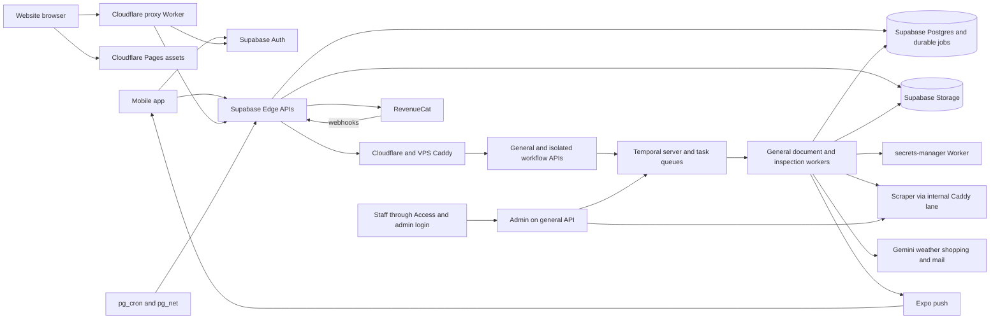

# Homekeepr system design

**Last source verification: 2026-11-04.** This is the shared cross-repository map, not a deployment receipt or a replacement for feature designs. The same bytes belong in every included repository. Evidence is pinned to the source commits below; code/configuration wins over older notes and diagrams. No production system, customer data, secret value, or dashboard configuration was accessed for this verification.

## 1. Repository map and deployment ownership

| Repository | Responsibility and runtime | Deployment path established by repository evidence |
| --- | --- | --- |
| `Homekeepr` | TypeScript, React Native/Expo mobile app with native iOS/Android projects. | GitHub `verify.yml` verifies, not deploys. Xcode Cloud has executable bootstrap/archive hooks; EAS also defines development/preview/production builds. Android has signed Gradle release configuration. Current Xcode Cloud distribution settings and Play upload automation are open questions. [A1] [A2] [A3] [A4] [A16] |
| `supabase` | TypeScript/Deno Edge functions, SQL migrations, Auth configuration, application Postgres and Storage contracts. Local config targets PostgreSQL 17 and Deno 2. | README states merge auto-deploys via the managed platform; no checked-in deployment workflow was found. Migrations/functions are separate rollout surfaces; platform integration, migration-before-function ordering and active production/preview revisions are not proven by this checkout. [B1] [B2] |
| `temporal-jobs` | TypeScript; Node 24 workers/dedicated APIs and a Bun generic HTTP/admin API; Temporal orchestration on the VPS. | GitHub `temporal-workers-build.yml` builds and type-checks, not deploys. `temporal-workers/scripts/redeploy-api.sh` rebuilds/recreates selected Compose services and checks health/readiness. Main worker and isolated document/inspection pairs are selectable. [T1] [T2] [T3] |
| `homekeepr.co` | Static HTML/CSS plus compiled/bundled TypeScript; separate TypeScript Cloudflare proxy Worker. | Pages publishes `dist/` according to README. Worker is separately deployed with Wrangler using `workers/web-onboarding-proxy/wrangler.toml`, including named staging configuration. Pages Git integration/branch/build settings are external state, not established by source. [W1] [W2] [W3] [W10] |
| `VPS-Infra-Services` | Caddy configuration, Docker Compose, shared Docker networks and security sidecar configuration. | Operator-managed VPS Compose/Caddy configuration. `VPS_DEPLOYMENT_DESIGN.md` explicitly describes a **not-yet-implemented plan**, not an existing GitHub SSH deployment workflow. Start this stack before dependent stacks because it creates their external networks. [I1] [I2] [D5] |
| `documentation-scraper` | Python FastAPI/Uvicorn, Selenium/Chrome, SQLite and local PDF blob storage. | VPS Docker Compose: four app replicas and two Squid proxies. `deploy.sh` pulls source, builds the app and attempts an eight-to-four replica rollout; no scraper CI deployment workflow was found. The script is a procedure, not proof of zero-downtime behavior or live revision. [S1] [S2] [S3] [S4] |
| `secrets-manager` | TypeScript Cloudflare Worker; scoped secret delivery using `AUTH_STORE` KV authorization metadata. | Wrangler configuration defines separate staging and production Workers/KV bindings. Package has local `dev` and manual `deploy` scripts. [K1] [K2] [K3] |
| `homekeepr-outbound` | TypeScript/Node Express product-research API, Next.js dashboard and ingestion workspace; separate development Postgres. | Included because current core Caddy configuration actively routes `outbound.homekeepr.co` to its named upstream. Its repository Compose describes development services, not a verified production stack or deploy automation. Live liveness and production packaging remain open. [I2] [O1] [O2] |

**Optional-repository decisions.** `documentation-scraper` is included by the mobile workspace's executable Compose include and Caddy routes; Temporal configuration requires `secrets-manager` access. `homekeepr-outbound` is included for its active Caddy route, not inferred from recent activity. `homekeepr-website` is excluded: the core search found an editor workspace entry and historical prose, but no executable runtime/deploy reference; the current website build and Worker live in `homekeepr.co`. This does not prove that no legacy deployment exists. `battle-chip*` and `ai-captcha-bypass` repositories are intentionally out of scope; the configured security sidecar is still described below. [A5] [A6] [T4] [I2]

## 2. Hosts, services and trust boundaries

### VPS: shared ingress and background execution

The infrastructure README identifies an Ubuntu Server 24 LTS host on Hetzner. Host capacity, region, running image IDs and checkout revisions are not independently established here. [I3]

| Stack | Configured service/container role | Exposure and persistence |
| --- | --- | --- |
| Infrastructure | `caddy`; `battle-chip` prebuilt audit-mode security sidecar | Caddy publishes HTTPS 443 and joins all three shared networks. Sidecar has host/security privileges and a mounted policy; it is not an application API. [I1] |
| Temporal infrastructure | `postgresql`, `temporal`, `temporal-ui` | PostgreSQL 16 with `temporal-db` volume stores **Temporal state**, not the Supabase application database. Temporal gRPC 7233 and UI 8080 publish to host loopback only. [T5] |
| General execution | `worker`; `api` (container DNS name `temporal-jobs`) | Worker has multiple task-queue pollers; Bun API publishes host-loopback 3033 and serves workflow starts, `/admin*`, and quiz-email preview. [T5] [T6] |
| Home Document execution | `home-document-worker`, `home-document-api` | Dedicated extraction worker; optional insurance, AMH and property-tax pollers. API defaults to 3036, with `/health` and `/ready`; feature readiness depends on gates/credentials. [T5] [T7] |
| Home Inspection execution | `home-inspection-worker`, `home-inspection-api` | Separate inspection queue and API, default port 3034; `/health` and `/ready`. [T5] [T8] |
| Manuals corpus | Scraper `app` ×4; `squid-proxy-a`, `squid-proxy-b` | Only app joins `documentation-scraper-network`; proxies stay on its per-stack bridge. Shared `manuals_data` volume holds SQLite/PDF data; this is not Supabase Storage. [S1] [S3] |
| Outbound tool | Configured `homekeepr-outbound` upstream | Caddy forwards to port 4000. The checked-in development Compose's `core-api`, `dashboard`, `postgres`, workspace/migration helpers and optional job profiles do not establish deployed production container names. [I2] [O1] |

Infrastructure creates `documentation-scraper-network`, `temporal-jobs-network` and `homekeepr-outbound-network`. Temporal's network named `internal` is a normal bridge, **not** Docker `internal: true`; application workers and dedicated APIs also join the external Temporal network. Do not copy older comments claiming only the generic API joins it or that Caddy prevents every cross-service pivot. [I1] [T5]

### Caddy route contract

All four public hostname blocks require verified Cloudflare origin-pull client certificates. That is origin mTLS, not user authentication. API credentials and application/Access controls are separate boundaries. [I2]

| Host/listener | Allowed routes and destination |
| --- | --- |
| `api.homekeepr.co` | Scraper replicas on 8000, least-connections balancing and `/health` checks; public `/health` and `/status` return 404. |
| `temporal.homekeepr.co` | `/start-workflow`, `/start-workflow-v2`, `/start-reprocessing`, `/start-task-reminder`, `/start-weather-ingestion`, `/start-weather-ingestion-bootstrap`, `/start-home-photo`, `/gift-order-signal`, `/quiz-results-email` → generic API 3033. |
| Same Temporal host | `/start-home-document`, `/start-insurance-checkup`, `/start-amh-chat`, `/start-property-tax-checkup` → Home Document API 3036; `/start-home-inspection` → Home Inspection API 3034. Other paths return 404. |
| `admin.homekeepr.co` | Only `/admin*` and `/quiz-email-preview*` → generic API 3033; other paths return 404. |
| `outbound.homekeepr.co` | Named outbound upstream on 4000. |
| Docker-only Caddy listener 8080 | Private-range client allowlist; `/api/*` strips prefix and forwards to scraper, `/temporal/*` strips prefix and forwards to generic API. Not published on the host. This is an internal lane without TLS/client certificates, not a general bypass of application authentication. |

The entire route table is sourced from [I2]. An implemented API route is not automatically a public route: generic API shopping start endpoints exist but are **not** in the current public Caddy allowlist. [T6] Any new public workflow path requires coordinated Edge, API and Caddy changes.

### Supabase: application system of record

Use project **roles**, never project identifiers, to discuss environments: **production**, **PR preview**, and **local/disposable release-staging**. Notes describe preview provisioning and managed auto-deploy; source establishes local configuration and redirect roles, not the existence, isolation or current version of every hosted project. Payment `SANDBOX` versus `PRODUCTION` is a RevenueCat data dimension, not proof of separate Supabase projects. [B1] [B2] [B8]

- **Auth:** email/password and OAuth/native Apple exchanges from clients; configured confirmation, token rotation and operation-specific redirects. `home-data` performs its own `auth.getUser()` and lifecycle/permission checks even though gateway `verify_jwt` is disabled for that function. [A7] [B1] [B3]
- **Postgres:** `restricted_home` owns homes/assets/jobs/documents/tasks; `private` owns billing/notification orchestration; `web_preconv` holds website funnel state. Configured schema exposure does not imply unrestricted grants. [B1] [B4] [B8] [T10]
- **Edge functions:** `home-data` is the application router; `workflow-starter` recovers durable jobs; `billing` handles RevenueCat intake/reconciliation/purchase; `gift` handles gift lifecycle; `web-onboarding` handles quiz/session/onboarding. Remaining legacy functions must not be mistaken for the authoritative current path just because their source exists. The `stripe` entrypoint is deliberately a side-effect-free 410 tombstone. [B2] [B5] [B6] [B7] [B9]
- **Storage:** private `documents` (home-owned files and current Home Plan evidence), `service_manuals` (shared model manuals), `note-photos`, `home-photos`, and `web-onboarding-previews`. Current Home Plan uploads use `documents`, not historical `home-plan-evidence`. [B10] [B11] [B12] [B13] [B14] [B15]
- **Scheduled work:** SQL `pg_cron` uses `pg_net`/`net.http_post` for minutely workflow recovery and billing reconciliation. AMH terminal-job pruning is separate. Weekend Warrior includes a separately controlled minutely tag-flow scheduler and native Mailchimp handoff; scheduler/configuration existence does not establish live enablement. [B16] [B17] [B18] [B19] [B20]

### Cloudflare and external providers

Cloudflare owns the checked-in website Worker routing and secrets-manager Worker/KV definitions; site docs specify Pages publication. Caddy expects Cloudflare in front of VPS public hosts, and admin is designed for Cloudflare Access plus its own login. DNS records, Access applications/policies, WAF/Turnstile dashboard settings and actual Pages linkage cannot be reconstructed fully from source. Separate Worker environments do **not** guarantee separate backend data: checked-in site staging/production upstream origins match. [I2] [I3] [W2] [W10] [K1] [D4]

| Provider | Code-established integration |
| --- | --- |
| RevenueCat / Apple / Google Play | Native purchases, web checkout, provider webhooks and canonical paid-access projection. SDK completion alone does not grant app access. [A8] [W4] [B2] [B7] |
| Stripe | Historical Homekeepr billing implementation is inactive behind a 410 entrypoint; legacy referral URLs redirect to `/buy`. No new entitlement decisions should use those historical tables/handlers. Provider-internal payment processing and outstanding account-side webhook settings remain external questions. [B2] [W5] |
| Google Gemini | Document extraction, embeddings, inspection/checkup analysis and home-photo generation; AMH retrieval/answer orchestration resides in Edge even when Temporal supplies durable execution. Do not infer one model/version for every operation. [T9] [T11] [T12] [B21] |
| Google Maps / RentCast | Street View source imagery for worker home photos; property enrichment is part of the onboarding implementation/design surface. Provider availability/configuration is deployment state. [T12] [D2] |
| Serper / scraper browser dependencies | Shopping/manual discovery; the scraper module is historically named `serpapi_scraper`, but its current client calls Serper and accepts `SERPER_API_KEY` or the historical `SERPAPI_KEY` name. CAPTCHA bridge defaults to 2Captcha, with an alternative legacy solver. [S5] [S6] |
| Expo | Push delivery and receipt lookup; persisted carousel entries are a different channel, not proof a push arrived. [T10] [A9] |
| Mailchimp / Visual Crossing / Resend | Customer enrichment/quiz and gift email integrations, Weekend Warrior tag flow, weather ingestion and operational email. [T13] [B9] [B20] |
| PostHog / Sentry / Grafana | Client product analytics, per-process/Edge error instrumentation and Caddy metrics configured for Grafana Cloud export. Do not interpret configured telemetry as proof of healthy dashboards or ingestion. [A17] [T4] [T7] [B21] [I2] |

## 3. Main request and data flows

The diagram groups processes for readability; it does not assert feature gates are enabled or that every journey uses Temporal. Detailed contracts follow.

### Auth and customer lifecycle

Mobile password signup/login supplies Turnstile tokens to Supabase Auth; Google OAuth exchanges a code, and native Apple exchanges an identity token plus nonce. Website bootstraps a PKCE Auth client through Worker-mediated configuration. App data calls use `/functions/v1/home-data/api/v0`; authoritative lifecycle endpoints include `POST /lifecycle/resolve`, `/lifecycle/home-draft/address`, and `/lifecycle/home-draft/confirm`. Client lifecycle revisions prevent older snapshots overwriting newer state. Access derives from server lifecycle, not a client-side purchase callback. [A7] [A8] [A18] [A19] [A20] [W6] [B3] [B22]

### Onboarding and inspection → review → Home Plan

Web quiz/session/address APIs pass through the same-origin Worker, which allowlists methods/routes and keeps session credentials in an HttpOnly first-party cookie. Authenticated session claim/checkout/lifecycle completion are explicit steps. Mobile address confirmation and Home Plan operate through `home-data`, not directly against the VPS. [W7] [B6] [B22]

Inspection intake prepares a submission, uploads bytes through a signed Storage capability, then finalizes through `/homes/:homeId/home-plan/evidence/uploads/:submissionId/finalize`. The client hashes the file; finalization is authoritative even if the upload response was lost. Current evidence is in private `documents`. SQL finalization creates `home_inspection_processing` or `home_document_processing`; Edge dispatches a job ID to its dedicated API. Workers publish extraction/proposal state back to Supabase. Clients poll inspection results and explicitly confirm findings/detected assets/tasks; extraction is not equivalent to user approval. [A11] [B10] [B23] [T8] [T11]

### Appliance label, customer document and staff manual upload

1. Mobile sends a label image to `/document-text-extraction`, confirms brand/model/serial and saves `/assets`; an optional appliance-photo description is a separate request. Paid/permission gates apply in Edge. This label OCR call is not itself proof of a separate label Temporal queue. [A12] [B24]
2. Model-document jobs use the document workflow path; target model/version/generation determines V1 versus V2 dispatch. Manual fetch goes through the scraper; returned PDFs are uploaded/indexed into Supabase, with `document_metadata` and `document_chunks` supporting shared model retrieval. Customer manual uploads instead enter `/document-upload` with a home/asset target; do not confuse them with staff scraper ingestion. [A13] [T9] [T14] [B25]
3. Staff `admin.homekeepr.co/admin` is served by the general API. Admin multipart upload forwards to scraper `POST /ingest/{brand}/{model}` using `X-Homekeepr-Ingest`, then signal-with-starts `retryScrape` for the document workflow. Scraper's general `X-Homekeepr-Scraper` and ingest credentials are distinct; missing ingest configuration disables that endpoint. [T15] [S2]
4. Legacy manual workflows wait/retry on scrape misses/errors and can be woken by staff upload. Missing-manual intervals progress through 2h, 6h, 12h, then repeated weekly waits; scraper errors have additional short retries. A successful scraper upload can precede a failed resume signal, which is recorded separately. Do not generalize this retry policy to bounded insurance/checkup workflows. [T15] [T16]

### Ask My House

Mobile calls `/chat/document-retrieval` and recovers through `/chat/document-retrieval/result`; async UI/polling is not evidence that every request runs in Temporal. `AMH_TEMPORAL_ENABLED` defaults off. Inline execution stays in Edge; the Temporal path creates/reuses a durable `amh_chat_response`, starts `/start-amh-chat`, then the worker calls `home-data/api/v0/internal/amh-chat/process`. Edge performs retrieval/answer generation and persists the result. Both modes use durable acceptance when the additive RPC is available. RAG maintenance and paid-feature checks fail closed. [A14] [B21] [B26] [T17]

Document retrieval uses `restricted_home.match_document_chunks`; it is not a direct client query over all manuals. Completed responses are polled/recovered, with an optional `amh_chat_response_ready` push/deep link. Recovery also handles accepted pending/stale work, completion notification and temporary-file cleanup. [B27] [B5] [A9] [A14]

### Purchase, entitlement, gift and billing

Mobile configures RevenueCat for the authenticated Supabase user; native purchase/restore or account web checkout is followed by server lifecycle reconciliation. Guest website purchase sends receipt email, Turnstile and idempotency data through `/purchase/v1/start`; the backend chooses checkout identity/offering. Browser SDK success only wakes reconciliation. First-party purchase/session capabilities and explicit authenticated claim connect a paid guest purchase to an account; a scanner opening a private link must not claim it. [A8] [W4] [W8]

RevenueCat `POST /functions/v1/billing/revenuecat/webhook` is the provider intake; `/billing/revenuecat/sync` requires user authentication, and `/billing/sweep` has separate authorization. Canonical billing identities/snapshots, purchases, checkout attempts and conversion outbox live in `private`; scheduled reconciliation repairs projections. Keep provider event/idempotency/lifecycle boundaries intact. [B7] [B8] [B17]

Gifts have their own Edge function and `private.homekeepr_gift_orders` / `private.homekeepr_gift_deliveries`. Generic API `/gift-order-signal` signal-with-starts `gift-recipient:{orderId}` on `gift-fulfillment`; workflows delegate business actions back to `gift/v1/service/action`, with a separate Mailchimp webhook. A `billing_webhook` wake reason does not make the worker the billing authority. [B9] [B28] [T18]

### Notifications and admin operations

App registers Expo tokens in `restricted_home.devices`; logout removes the registered user/token pair. Campaign/rule execution uses Temporal plus `private` notification RPCs and preparation/run state; legacy workflow sends also retain a Supabase-client path. Shared notification payloads include home/recipient scope, push/carousel channels, deep links and idempotency keys. `home_events` is the in-app feed; Expo send/receipt outcomes are separate. Invalid tokens can be pruned and denied devices are skipped where explicitly checked. Taps invalidate relevant caches and route through the app deep-link registry. [A9] [T10] [B29]

Admin routes, database login/session logic, campaigns/rules and manual operations belong to `temporal-jobs`; Cloudflare Access policy belongs outside that repo. Generic API schedule provisioning is opt-in via `TEMPORAL_API_PROVISION_SCHEDULES`, not automatic on every startup. Never treat admin UI rendering, a recorded campaign, or configured cron as proof that a customer notification was sent. [D4] [T6] [T19]

## 4. Cross-repository contracts

### Durable work and Temporal task queues

`restricted_home.jobs` records accepted work before dispatch, with status, workflow ID, attempts, file pointers/config/result and timestamps. `workflow-starter` is minutely HTTP recovery, not a worker polling the jobs table. Its bounded recovery groups avoid one queue starving the others; V2 asset processing fences model/version/generation. Workflow IDs and API response casing are part of the transport contract, not interchangeable task-queue names. [B4] [B5] [B16] [T14] [T7] [T8]

| Application job | Start path | Temporal task queue |
| --- | --- | --- |
| `document_processing`, legacy targetless | `/start-workflow` | `document-processing` |
| `document_processing`, complete version target | `/start-workflow-v2` | `document-processing-v2` |
| `home_photo_generation` | `/start-home-photo` | `home-photo` |
| `home_inspection_processing` | `/start-home-inspection` | `home-inspection` |
| `home_document_processing` | `/start-home-document` | `home-document-processing` |
| `insurance_checkup` | `/start-insurance-checkup` | `insurance-checkup-processing` |
| `amh_chat_response` | `/start-amh-chat` | `amh-chat-processing` |
| `property_tax_checkup` | `/start-property-tax-checkup` | `property-tax-checkup-processing` |

Mapping: [T14] [T20] [T21] [T22]. Other worker queues are `notification-delivery` (reminders, campaigns/rules, weather, shopping, Mailchimp, quiz recovery, weekly picks), `gift-fulfillment`, and optionally `weekend-warrior`. A queue existing in code is not proof a poller or schedule is enabled. [T20] [T7]

Edge ingress variables are `TEMPORAL_HTTP_API`, optional `TEMPORAL_INSPECTION_HTTP_API`, explicit `TEMPORAL_HOME_DOCUMENT_HTTP_API`, and `TEMPORAL_API_KEY`. Newer insurance/AMH/property-tax starts require configured isolated ingress rather than silently falling back to the generic endpoint. Start APIs use Bearer authentication; secrets-manager uses its own raw Authorization-header contract instead. [B25] [T4] [K3]

### Shared data and file ownership

| Contract | Producers / consumers and invariant |
| --- | --- |
| `restricted_home.property`, assets/models and `jobs` | Edge owns acceptance/permission checks; workers load durable identifiers and publish results. Temporal's own PostgreSQL is a separate database. [B4] [T5] |
| `document_metadata`, `document_chunks`, `service_manuals` | Model-scoped service manuals can be shared across homes; private home evidence stays in `documents`. Preserve scope and retrieval authorization; do not copy scraper SQLite assumptions into Supabase cardinality rules. [T9] [B10] [B11] [B27] |
| `home_evidence_submission`, `home_inspection_extraction` and Home Plan proposal/confirmation | Signed-upload finalization starts extraction; explicit customer confirmation owns plan/asset/task acceptance. [A11] [B23] [T11] |
| Insurance SQL claims + exact file capabilities | Worker uses scoped insurance DB claim/publish/fail RPCs; `home-data/api/v0/internal/insurance-checkup/files` grants narrow files using the live claim. Not a permanent all-bucket Storage credential. [T23] |
| Billing and gift `private` tables | RevenueCat projection and explicit claim/lifecycle transitions; Edge owns provider/webhook boundaries and worker service actions. [B8] [B9] [B28] |
| `devices`, `user_property`, `home_events`, notification runs/preparations | Device/membership targeting, feed visibility, delivery idempotency and push receipt cleanup must stay consistent across app, Edge and workers. [A9] [T10] [B29] |

**Credentials are mixed, not uniformly least-privilege.** Campaign, shopping, Mailchimp, Home Document and insurance paths use different scoped PostgreSQL contracts; legacy document/notification paths and some Storage access still use broad Supabase clients. Insurance has stronger runtime identity/role/file-capability checks. Secrets-manager runtime refresh/cache and database/server boot-time secret fetches are separate mechanisms; do not promise that every credential rotates live without a restart. [T4] [T10] [T23] [T24]

## 5. Where to change X

| Change | Primary owner; coordinated surfaces |
| --- | --- |
| Mobile screen/navigation, capture, deep link or polling | `Homekeepr/src/screens`, `src/services`, `src/navigation`; pair with Edge request/response schema and notification payload when applicable. [D1] |
| Application permissions, home/asset data, Auth callbacks or lifecycle | `supabase/supabase/functions/home-data`, shared subscription/lifecycle helpers, `supabase/config.toml`, SQL migrations; client lifecycle integration. [D2] |
| Inspection/checkup result or file ownership | Edge Home Plan handlers + owning migrations, dedicated Temporal activity/workflow, mobile review/confirmation UI; read storage conventions first. [D1] [D2] [D3] |
| Async work/recovery | Supabase job creation, `workflow-starter/dispatch.ts`, shared Temporal client; matching API/schema/client/worker queue in Temporal; public path allowlist in infra. [B25] [T14] [I2] |
| Manual discovery, scraper ingest or retry/admin repair | Scraper `app/` and discovery modules; Temporal document activities/workflows and `src/admin.ts`; Caddy scraper lane. [D3] [D6] |
| Paid access, checkout, gifts or provider webhooks | Supabase `billing`, `gift`, lifecycle SQL; website purchase/claim Worker and mobile RevenueCat/lifecycle services. Never resurrect legacy Stripe truth. [B2] [B7] [B9] [W8] |
| Marketing/quiz, Pages assets or proxy routes | `homekeepr.co/src/ts`, templates/build outputs; Worker source and Wrangler routes; Supabase `web-onboarding`; consult existing blog skill for blog changes. [D7] |
| Push/carousel campaign or weather targeting | Temporal notification workflows/activities/admin; Supabase notification SQL/Edge sender; mobile token/deep-link/cache behavior. [T10] [B29] [A9] |
| Public hostname/new VPS endpoint/network | `VPS-Infra-Services/caddy/Caddyfile` and Compose, upstream API and Edge ingress configuration; dashboard DNS/Access changes need separate operator ownership. [I1] [I2] |
| Machine secret scope/refresh | `secrets-manager/src/index.ts`, Wrangler KV environment; Temporal config/cache and separately bootstrapped PostgreSQL/Temporal entrypoints. Values never belong in docs or PRs. [K1] [K3] [T4] [T24] |

## 6. Local development wiring

Keep repositories as siblings when using the checked-in mobile Compose aggregator: it includes scraper, Temporal and infra Compose files by relative path. It does not include Supabase, outbound or the website. Infra owns the shared networks and must start first. Runtime setup requires local-only secrets/certificates/sidecar configuration; this document intentionally contains no environment assignments or credential values. Do not aim a local runner at production to make missing setup disappear. [A5] [I1]

- **Supabase:** use the CLI's local stack and the repo's `run.sh` Edge runner (`bunx supabase functions serve`); follow its repository-scoped environment-file checks. API/DB/Studio use local ports 54321/54322/54323. Reset only disposable local databases according to the existing runbook. [B1] [B30] [D3]
- **Mobile:** existing simulator instructions use the Expo dev client on localhost, not generic React Native Metro alone. `mobile:metro` and `mobile:doctor` scripts are provided. Development URL selection distinguishes release-staging, explicit local runtime configuration and inferred Metro host; non-development binaries select production. Read the documented release-staging launcher before testing checkout/lifecycle. [A1] [A15] [D8]
- **Website:** `bun run build` invokes the existing static build; `bun run dev:onboarding` launches static assets on 8788 and the proxy Worker on 8789, but does not start Supabase. Required names include `SUPABASE_ANON_KEY`, `SUPABASE_SERVICE_ROLE_KEY`, `PROXY_SECRET`, `PREVIEW_PROXY_TOKEN_SECRET`, `HOMEKEEPR_GIFT_PROXY_SECRET`, and for purchase `HOMEKEEPR_PURCHASE_PROXY_SECRET`. Use local bindings only. [W1] [W9]
- **Secrets/Temporal:** secrets-manager `bun run dev` provides local Wrangler on 8787. Temporal local admin wiring needs local Supabase and local machine authorization; generic API uses 3033, dedicated APIs 3036/3034, Temporal 7233 and UI 8080. Container access to host-local dependencies uses `host.docker.internal`, not the Temporal infrastructure database. Read the local admin runbook; API-only database/admin rendering and workflow execution have different dependencies. [K2] [D3]
- **Scraper/outbound:** consult their existing source/runbooks rather than treating development Compose as a production recipe. Scraper requires its browser/proxy configuration and local corpus storage; outbound's development Compose includes its own Postgres/API/dashboard and optional ingestion/ops profiles. No outbound production deployment is verified. [S1] [S3] [O1]

These are documentation pointers, not commands executed during this audit. Existing package-manager pins/build steps remain authoritative; the Bun commands above identify package scripts without migrating repository tooling.

## 7. Existing architecture and operator references

Follow these for feature detail instead of maintaining a second copy here. Some are historical or explicitly proposed; executable source takes precedence.

- **Mobile:** [system overview][D9], [document graph][D1], [storage conventions][D10], [feature designs][D11], [mobile validation harness][D12], and [release-staging guide][D8].
- **Supabase:** [README][B2], [document graph][D2], [feature designs][D13] and [operations/scripts guide][D14].
- **Temporal/admin:** [worker README][D15], [document graph][D16], [feature designs][D17], [local admin guide][D3] and [admin operator notes][D4].
- **Website:** [README][W2], [document graph][D7], [Worker guide][W3] and [feature designs][D18].
- **Infrastructure:** [README][I3], [Caddy/network designs][D19] and [deployment proposal, not implemented CI][D5].
- **Scraper:** [README][D6], [discovery design][D20] and [manual-ingest design][D21]. README's proposed production database/search diagram is not evidence replacing the actual SQLite/filesystem implementation.
- **Secrets/outbound:** [secrets-manager guide][D22], [original Worker design][D23], [outbound source/scripts][O2] and [development Compose][O1].

## 8. Open questions

1. **Live deployments:** which source SHAs/images/services/sidecar policy and feature flags actually run on the VPS, and which Edge versions/migrations are active? No production access was allowed; all service inventories above are configured topology.
2. **Hosted project roles:** which production/PR-preview projects are linked to GitHub, what is the migration/function rollout ordering, and what preview isolation/secrets provisioning is configured? Source redirects/local config and README auto-deploy assertions do not settle platform state.
3. **Cloudflare external state:** exact DNS targets, Pages project/production branch/build settings, Access application/policies, WAF/rate-limiting rules and origin-certificate provisioning. Wrangler/Caddy establish expected routing, not those dashboard settings.
4. **Staging data isolation:** site Worker production/staging sections currently select the same upstream origin. Is shared backend intentional, or should staging use a separate project? Different Worker names do not answer this.
5. **Mobile release ownership:** active Xcode Cloud workflow/distribution and EAS usage; Android Play upload automation/owner/track. Source hooks, build profiles and signing configuration do not prove store delivery or that a particular fix shipped.
6. **Optional legacy services:** does the routed outbound upstream exist and serve traffic, and which production packaging matches it? Is any old `homekeepr-website` deployment retained? Inclusion/exclusion here follows core executable references, not live traffic.
7. **Runtime activation:** AMH Temporal mode, insurance/property-tax capabilities, gift flags, Weekend Warrior configuration and schedule provisioning depend on deployment state. Do not enable them based on this document.
8. **Provider-side configuration:** RevenueCat webhook destinations/authorized credentials, outstanding Stripe endpoints/subscriber servicing, mail-provider flows and telemetry ingestion/alerts need authorized operator verification. Source alone cannot confirm them.

## 9. Source snapshot provenance

Fresh organization clones, origin default branch `main`, captured before documentation edits. These are **source baselines**, not PR head SHAs or deployed revisions. Update the shared document everywhere together when the verified map changes.

| Repository | Verified source commit | Included |
| --- | --- | --- |
| `Homekeepr` | `d5f65558cbca51bb0a82e8e4a3dc17f53db1a701` | Yes |
| `supabase` | `eb7625d7d9828b349ecf08f3cfd58ce39a8c2ddd` | Yes |
| `temporal-jobs` | `64d29626b45c484293fddfbb2b58e77819665f5e` | Yes |
| `homekeepr.co` | `aacf2730b11fdc3a20836b12445b1fe914200ddf` | Yes |
| `VPS-Infra-Services` | `b301b3156c13ad872f9c10c38483c1483950ddf9` | Yes |
| `documentation-scraper` | `2dabe49e3faa85d4bdca0deea9c8feea4e41663c` | Yes |
| `homekeepr-outbound` | `769e06cd3b52b81901787c15ca4c6785dc44168e` | Yes |
| `homekeepr-website` | `013a2dcbddcf1ab5d5bf878c1d2712b34acedf45` | No; inspected for inclusion |
| `secrets-manager` | `985a23c8ceb1f20598f1ea65f2f4078bcfdb9ed8` | Yes |

<!-- Evidence links use immutable source commits so they resolve identically in every repository. -->
[A1]: https://github.com/Homekeepr-Inc/Homekeepr/blob/d5f65558cbca51bb0a82e8e4a3dc17f53db1a701/package.json#L15-L111
[A2]: https://github.com/Homekeepr-Inc/Homekeepr/blob/d5f65558cbca51bb0a82e8e4a3dc17f53db1a701/.github/workflows/verify.yml#L1-L59
[A3]: https://github.com/Homekeepr-Inc/Homekeepr/blob/d5f65558cbca51bb0a82e8e4a3dc17f53db1a701/ci_scripts/ci_post_clone.sh#L6-L225
[A4]: https://github.com/Homekeepr-Inc/Homekeepr/blob/d5f65558cbca51bb0a82e8e4a3dc17f53db1a701/eas.json#L1-L21
[A5]: https://github.com/Homekeepr-Inc/Homekeepr/blob/d5f65558cbca51bb0a82e8e4a3dc17f53db1a701/docker-compose.yml#L1-L4
[A6]: https://github.com/Homekeepr-Inc/Homekeepr/blob/d5f65558cbca51bb0a82e8e4a3dc17f53db1a701/Homekeeper.code-workspace#L15-L25
[A7]: https://github.com/Homekeepr-Inc/Homekeepr/blob/d5f65558cbca51bb0a82e8e4a3dc17f53db1a701/src/services/socialAuthService.ts#L136-L152
[A8]: https://github.com/Homekeepr-Inc/Homekeepr/blob/d5f65558cbca51bb0a82e8e4a3dc17f53db1a701/src/services/revenueCatService.ts#L91-L160
[A9]: https://github.com/Homekeepr-Inc/Homekeepr/blob/d5f65558cbca51bb0a82e8e4a3dc17f53db1a701/src/services/pushNotificationService.ts#L445-L998
[A10]: https://github.com/Homekeepr-Inc/Homekeepr/blob/d5f65558cbca51bb0a82e8e4a3dc17f53db1a701/app.config.js#L151-L172
[A11]: https://github.com/Homekeepr-Inc/Homekeepr/blob/d5f65558cbca51bb0a82e8e4a3dc17f53db1a701/src/services/homePlanOnboardingService.ts#L1247-L1683
[A12]: https://github.com/Homekeepr-Inc/Homekeepr/blob/d5f65558cbca51bb0a82e8e4a3dc17f53db1a701/src/services/applianceOnboardingService.ts#L154-L380
[A13]: https://github.com/Homekeepr-Inc/Homekeepr/blob/d5f65558cbca51bb0a82e8e4a3dc17f53db1a701/src/screens/DocumentUploadScreen.tsx#L185-L250
[A14]: https://github.com/Homekeepr-Inc/Homekeepr/blob/d5f65558cbca51bb0a82e8e4a3dc17f53db1a701/src/screens/components/AskMyHouseChat.tsx#L985-L1217
[A15]: https://github.com/Homekeepr-Inc/Homekeepr/blob/d5f65558cbca51bb0a82e8e4a3dc17f53db1a701/src/services/supabase.ts#L168-L325
[A16]: https://github.com/Homekeepr-Inc/Homekeepr/blob/d5f65558cbca51bb0a82e8e4a3dc17f53db1a701/android/app/build.gradle#L95-L129
[A17]: https://github.com/Homekeepr-Inc/Homekeepr/blob/d5f65558cbca51bb0a82e8e4a3dc17f53db1a701/App.tsx#L33-L66
[A18]: https://github.com/Homekeepr-Inc/Homekeepr/blob/d5f65558cbca51bb0a82e8e4a3dc17f53db1a701/src/screens/AuthScreen.tsx#L315-L394
[A19]: https://github.com/Homekeepr-Inc/Homekeepr/blob/d5f65558cbca51bb0a82e8e4a3dc17f53db1a701/src/services/socialAuthService.ts#L635-L638
[A20]: https://github.com/Homekeepr-Inc/Homekeepr/blob/d5f65558cbca51bb0a82e8e4a3dc17f53db1a701/src/context/CustomerLifecycleContext.tsx#L220-L237
[B1]: https://github.com/Homekeepr-Inc/supabase/blob/eb7625d7d9828b349ecf08f3cfd58ce39a8c2ddd/supabase/config.toml#L7-L427
[B2]: https://github.com/Homekeepr-Inc/supabase/blob/eb7625d7d9828b349ecf08f3cfd58ce39a8c2ddd/README.md#L67-L129
[B3]: https://github.com/Homekeepr-Inc/supabase/blob/eb7625d7d9828b349ecf08f3cfd58ce39a8c2ddd/supabase/functions/home-data/middleware.ts#L89-L180
[B4]: https://github.com/Homekeepr-Inc/supabase/blob/eb7625d7d9828b349ecf08f3cfd58ce39a8c2ddd/supabase/migrations/20260113000001_create_jobs_table.sql#L15-L103
[B5]: https://github.com/Homekeepr-Inc/supabase/blob/eb7625d7d9828b349ecf08f3cfd58ce39a8c2ddd/supabase/functions/workflow-starter/index.ts#L40-L220
[B6]: https://github.com/Homekeepr-Inc/supabase/blob/eb7625d7d9828b349ecf08f3cfd58ce39a8c2ddd/supabase/functions/web-onboarding/index.ts#L744-L1053
[B7]: https://github.com/Homekeepr-Inc/supabase/blob/eb7625d7d9828b349ecf08f3cfd58ce39a8c2ddd/supabase/functions/billing/index.ts#L587-L1043
[B8]: https://github.com/Homekeepr-Inc/supabase/blob/eb7625d7d9828b349ecf08f3cfd58ce39a8c2ddd/supabase/migrations/20260920225815_add_pay_first_purchase_claims.sql#L6-L60
[B9]: https://github.com/Homekeepr-Inc/supabase/blob/eb7625d7d9828b349ecf08f3cfd58ce39a8c2ddd/supabase/functions/gift/index.ts#L474-L954
[B10]: https://github.com/Homekeepr-Inc/supabase/blob/eb7625d7d9828b349ecf08f3cfd58ce39a8c2ddd/supabase/functions/home-data/home-plan.ts#L1184-L1186
[B11]: https://github.com/Homekeepr-Inc/supabase/blob/eb7625d7d9828b349ecf08f3cfd58ce39a8c2ddd/supabase/migrations/20251103000007_service_document_scope_storage.sql#L3-L104
[B12]: https://github.com/Homekeepr-Inc/supabase/blob/eb7625d7d9828b349ecf08f3cfd58ce39a8c2ddd/supabase/migrations/20260123000002_create_note_photos_bucket.sql#L5-L10
[B13]: https://github.com/Homekeepr-Inc/supabase/blob/eb7625d7d9828b349ecf08f3cfd58ce39a8c2ddd/supabase/migrations/20260217000001_add_home_photo_columns.sql#L15-L18
[B14]: https://github.com/Homekeepr-Inc/supabase/blob/eb7625d7d9828b349ecf08f3cfd58ce39a8c2ddd/supabase/migrations/20260310000001_create_web_preconv_schema.sql#L110-L113
[B15]: https://github.com/Homekeepr-Inc/supabase/blob/eb7625d7d9828b349ecf08f3cfd58ce39a8c2ddd/supabase/migrations/20250725204255_create_document_bucket.sql#L3-L6
[B16]: https://github.com/Homekeepr-Inc/supabase/blob/eb7625d7d9828b349ecf08f3cfd58ce39a8c2ddd/supabase/migrations/20260113000003_schedule_workflow_starter_cron.sql#L7-L42
[B17]: https://github.com/Homekeepr-Inc/supabase/blob/eb7625d7d9828b349ecf08f3cfd58ce39a8c2ddd/supabase/migrations/20260722000001_add_customer_lifecycle_foundations.sql#L4177-L4204
[B18]: https://github.com/Homekeepr-Inc/supabase/blob/eb7625d7d9828b349ecf08f3cfd58ce39a8c2ddd/supabase/migrations/20261004012348_amh_durable_responses.sql#L97-L101
[B19]: https://github.com/Homekeepr-Inc/supabase/blob/eb7625d7d9828b349ecf08f3cfd58ce39a8c2ddd/supabase/migrations/20261028032037_weekend_warrior_tagflow.sql#L390-L408
[B20]: https://github.com/Homekeepr-Inc/supabase/blob/eb7625d7d9828b349ecf08f3cfd58ce39a8c2ddd/supabase/functions/ww-tagflow/index.ts#L1-L23
[B21]: https://github.com/Homekeepr-Inc/supabase/blob/eb7625d7d9828b349ecf08f3cfd58ce39a8c2ddd/supabase/functions/home-data/index.ts#L2045-L2300
[B22]: https://github.com/Homekeepr-Inc/supabase/blob/eb7625d7d9828b349ecf08f3cfd58ce39a8c2ddd/supabase/functions/home-data/lifecycle.ts#L963-L1040
[B23]: https://github.com/Homekeepr-Inc/supabase/blob/eb7625d7d9828b349ecf08f3cfd58ce39a8c2ddd/supabase/migrations/20261012214221_property_tax_checkups.sql#L398-L413
[B24]: https://github.com/Homekeepr-Inc/supabase/blob/eb7625d7d9828b349ecf08f3cfd58ce39a8c2ddd/supabase/functions/home-data/index.ts#L766-L895
[B25]: https://github.com/Homekeepr-Inc/supabase/blob/eb7625d7d9828b349ecf08f3cfd58ce39a8c2ddd/supabase/functions/_shared/temporal-client.ts#L287-L331
[B26]: https://github.com/Homekeepr-Inc/supabase/blob/eb7625d7d9828b349ecf08f3cfd58ce39a8c2ddd/README.md#L311-L324
[B27]: https://github.com/Homekeepr-Inc/supabase/blob/eb7625d7d9828b349ecf08f3cfd58ce39a8c2ddd/supabase/functions/home-data/document-retrieval.ts#L1-L27
[B28]: https://github.com/Homekeepr-Inc/supabase/blob/eb7625d7d9828b349ecf08f3cfd58ce39a8c2ddd/supabase/migrations/20260716000001_add_homekeepr_gifting.sql#L7-L166
[B29]: https://github.com/Homekeepr-Inc/supabase/blob/eb7625d7d9828b349ecf08f3cfd58ce39a8c2ddd/supabase/functions/_shared/sendNotification.ts#L1-L562
[B30]: https://github.com/Homekeepr-Inc/supabase/blob/eb7625d7d9828b349ecf08f3cfd58ce39a8c2ddd/run.sh#L1-L19
[T1]: https://github.com/Homekeepr-Inc/temporal-jobs/blob/64d29626b45c484293fddfbb2b58e77819665f5e/temporal-workers/package.json#L1-L97
[T2]: https://github.com/Homekeepr-Inc/temporal-jobs/blob/64d29626b45c484293fddfbb2b58e77819665f5e/.github/workflows/temporal-workers-build.yml#L1-L37
[T3]: https://github.com/Homekeepr-Inc/temporal-jobs/blob/64d29626b45c484293fddfbb2b58e77819665f5e/temporal-workers/scripts/redeploy-api.sh#L151-L233
[T4]: https://github.com/Homekeepr-Inc/temporal-jobs/blob/64d29626b45c484293fddfbb2b58e77819665f5e/temporal-workers/src/config.ts#L151-L221
[T5]: https://github.com/Homekeepr-Inc/temporal-jobs/blob/64d29626b45c484293fddfbb2b58e77819665f5e/temporal-workers/docker-compose.yml#L25-L327
[T6]: https://github.com/Homekeepr-Inc/temporal-jobs/blob/64d29626b45c484293fddfbb2b58e77819665f5e/temporal-workers/src/api.ts#L282-L729
[T7]: https://github.com/Homekeepr-Inc/temporal-jobs/blob/64d29626b45c484293fddfbb2b58e77819665f5e/temporal-workers/src/homeDocumentWorker.ts#L45-L111
[T8]: https://github.com/Homekeepr-Inc/temporal-jobs/blob/64d29626b45c484293fddfbb2b58e77819665f5e/temporal-workers/src/homeInspectionApi.ts#L44-L110
[T9]: https://github.com/Homekeepr-Inc/temporal-jobs/blob/64d29626b45c484293fddfbb2b58e77819665f5e/temporal-workers/src/activities/index.ts#L57-L1444
[T10]: https://github.com/Homekeepr-Inc/temporal-jobs/blob/64d29626b45c484293fddfbb2b58e77819665f5e/temporal-workers/src/activities/notificationRuns.ts#L21-L669
[T11]: https://github.com/Homekeepr-Inc/temporal-jobs/blob/64d29626b45c484293fddfbb2b58e77819665f5e/temporal-workers/src/activities/homeInspection.ts#L1378-L1418
[T12]: https://github.com/Homekeepr-Inc/temporal-jobs/blob/64d29626b45c484293fddfbb2b58e77819665f5e/temporal-workers/src/activities/homePhoto.ts#L175-L286
[T13]: https://github.com/Homekeepr-Inc/temporal-jobs/blob/64d29626b45c484293fddfbb2b58e77819665f5e/temporal-workers/src/activities/weatherIngestion.ts#L503-L715
[T14]: https://github.com/Homekeepr-Inc/supabase/blob/eb7625d7d9828b349ecf08f3cfd58ce39a8c2ddd/supabase/functions/workflow-starter/dispatch.ts#L119-L169
[T15]: https://github.com/Homekeepr-Inc/temporal-jobs/blob/64d29626b45c484293fddfbb2b58e77819665f5e/temporal-workers/src/admin.ts#L2787-L2900
[T16]: https://github.com/Homekeepr-Inc/temporal-jobs/blob/64d29626b45c484293fddfbb2b58e77819665f5e/temporal-workers/src/workflows/documentProcessing.ts#L167-L199
[T17]: https://github.com/Homekeepr-Inc/temporal-jobs/blob/64d29626b45c484293fddfbb2b58e77819665f5e/temporal-workers/src/activities/amhChat.ts#L11-L38
[T18]: https://github.com/Homekeepr-Inc/temporal-jobs/blob/64d29626b45c484293fddfbb2b58e77819665f5e/temporal-workers/src/activities/gift.ts#L164-L283
[T19]: https://github.com/Homekeepr-Inc/temporal-jobs/blob/64d29626b45c484293fddfbb2b58e77819665f5e/temporal-workers/src/apiScheduleProvisioning.ts#L11-L22
[T20]: https://github.com/Homekeepr-Inc/temporal-jobs/blob/64d29626b45c484293fddfbb2b58e77819665f5e/temporal-workers/src/worker.ts#L43-L95
[T21]: https://github.com/Homekeepr-Inc/temporal-jobs/blob/64d29626b45c484293fddfbb2b58e77819665f5e/temporal-workers/src/homeDocumentClient.ts#L18-L166
[T22]: https://github.com/Homekeepr-Inc/temporal-jobs/blob/64d29626b45c484293fddfbb2b58e77819665f5e/temporal-workers/src/homeInspectionClient.ts#L14-L66
[T23]: https://github.com/Homekeepr-Inc/temporal-jobs/blob/64d29626b45c484293fddfbb2b58e77819665f5e/temporal-workers/src/activities/insuranceCheckup.ts#L35-L676
[T24]: https://github.com/Homekeepr-Inc/temporal-jobs/blob/64d29626b45c484293fddfbb2b58e77819665f5e/temporal-workers/packages/secrets-cache/src/index.ts#L62-L128
[W1]: https://github.com/Homekeepr-Inc/homekeepr.co/blob/aacf2730b11fdc3a20836b12445b1fe914200ddf/package.json#L15-L18
[W2]: https://github.com/Homekeepr-Inc/homekeepr.co/blob/aacf2730b11fdc3a20836b12445b1fe914200ddf/README.md#L7-L155
[W3]: https://github.com/Homekeepr-Inc/homekeepr.co/blob/aacf2730b11fdc3a20836b12445b1fe914200ddf/workers/web-onboarding-proxy/README.md#L46-L104
[W4]: https://github.com/Homekeepr-Inc/homekeepr.co/blob/aacf2730b11fdc3a20836b12445b1fe914200ddf/src/ts/purchase.ts#L223-L294
[W5]: https://github.com/Homekeepr-Inc/homekeepr.co/blob/aacf2730b11fdc3a20836b12445b1fe914200ddf/dist/_redirects#L1-L14
[W6]: https://github.com/Homekeepr-Inc/homekeepr.co/blob/aacf2730b11fdc3a20836b12445b1fe914200ddf/src/ts/supabase-auth.ts#L237-L495
[W7]: https://github.com/Homekeepr-Inc/homekeepr.co/blob/aacf2730b11fdc3a20836b12445b1fe914200ddf/workers/web-onboarding-proxy/src/routes.ts#L9-L138
[W8]: https://github.com/Homekeepr-Inc/homekeepr.co/blob/aacf2730b11fdc3a20836b12445b1fe914200ddf/workers/web-onboarding-proxy/src/purchase-routes.ts#L15-L493
[W9]: https://github.com/Homekeepr-Inc/homekeepr.co/blob/aacf2730b11fdc3a20836b12445b1fe914200ddf/workers/web-onboarding-proxy/dev-onboarding-local.sh#L3-L70
[W10]: https://github.com/Homekeepr-Inc/homekeepr.co/blob/aacf2730b11fdc3a20836b12445b1fe914200ddf/workers/web-onboarding-proxy/wrangler.toml#L1-L189
[I1]: https://github.com/Homekeepr-Inc/VPS-Infra-Services/blob/b301b3156c13ad872f9c10c38483c1483950ddf9/docker-compose.yml#L1-L64
[I2]: https://github.com/Homekeepr-Inc/VPS-Infra-Services/blob/b301b3156c13ad872f9c10c38483c1483950ddf9/caddy/Caddyfile#L1-L210
[I3]: https://github.com/Homekeepr-Inc/VPS-Infra-Services/blob/b301b3156c13ad872f9c10c38483c1483950ddf9/README.md#L1-L21
[S1]: https://github.com/Homekeepr-Inc/documentation-scraper/blob/2dabe49e3faa85d4bdca0deea9c8feea4e41663c/docker-compose.yml#L26-L94
[S2]: https://github.com/Homekeepr-Inc/documentation-scraper/blob/2dabe49e3faa85d4bdca0deea9c8feea4e41663c/app/main.py#L53-L226
[S3]: https://github.com/Homekeepr-Inc/documentation-scraper/blob/2dabe49e3faa85d4bdca0deea9c8feea4e41663c/app/config.py#L8-L15
[S4]: https://github.com/Homekeepr-Inc/documentation-scraper/blob/2dabe49e3faa85d4bdca0deea9c8feea4e41663c/deploy.sh#L14-L48
[S5]: https://github.com/Homekeepr-Inc/documentation-scraper/blob/2dabe49e3faa85d4bdca0deea9c8feea4e41663c/serpapi_scraper/client.py#L20-L39
[S6]: https://github.com/Homekeepr-Inc/documentation-scraper/blob/2dabe49e3faa85d4bdca0deea9c8feea4e41663c/serpapi_scraper/ai_captcha_bridge.py#L200-L204
[K1]: https://github.com/Homekeepr-Inc/secrets-manager/blob/985a23c8ceb1f20598f1ea65f2f4078bcfdb9ed8/wrangler.toml#L1-L22
[K2]: https://github.com/Homekeepr-Inc/secrets-manager/blob/985a23c8ceb1f20598f1ea65f2f4078bcfdb9ed8/package.json#L1-L16
[K3]: https://github.com/Homekeepr-Inc/secrets-manager/blob/985a23c8ceb1f20598f1ea65f2f4078bcfdb9ed8/src/index.ts#L139-L201
[O1]: https://github.com/Homekeepr-Inc/homekeepr-outbound/blob/769e06cd3b52b81901787c15ca4c6785dc44168e/infrastructure/docker-compose.yml#L18-L130
[O2]: https://github.com/Homekeepr-Inc/homekeepr-outbound/blob/769e06cd3b52b81901787c15ca4c6785dc44168e/package.json#L1-L20
[D1]: https://github.com/Homekeepr-Inc/Homekeepr/blob/d5f65558cbca51bb0a82e8e4a3dc17f53db1a701/DOCUMENT_GRAPH.md
[D2]: https://github.com/Homekeepr-Inc/supabase/blob/eb7625d7d9828b349ecf08f3cfd58ce39a8c2ddd/DOCUMENT_GRAPH.md
[D3]: https://github.com/Homekeepr-Inc/temporal-jobs/blob/64d29626b45c484293fddfbb2b58e77819665f5e/temporal-workers/docs/LOCAL_ADMIN.md
[D4]: https://github.com/Homekeepr-Inc/temporal-jobs/blob/64d29626b45c484293fddfbb2b58e77819665f5e/temporal-workers/src/admin/README.md
[D5]: https://github.com/Homekeepr-Inc/VPS-Infra-Services/blob/b301b3156c13ad872f9c10c38483c1483950ddf9/VPS_DEPLOYMENT_DESIGN.md
[D6]: https://github.com/Homekeepr-Inc/documentation-scraper/blob/2dabe49e3faa85d4bdca0deea9c8feea4e41663c/README.md
[D7]: https://github.com/Homekeepr-Inc/homekeepr.co/blob/aacf2730b11fdc3a20836b12445b1fe914200ddf/DOCUMENT_GRAPH.md
[D8]: https://github.com/Homekeepr-Inc/Homekeepr/blob/d5f65558cbca51bb0a82e8e4a3dc17f53db1a701/scripts/release-staging/README.md
[D9]: https://github.com/Homekeepr-Inc/Homekeepr/blob/d5f65558cbca51bb0a82e8e4a3dc17f53db1a701/SYSTEM_DESIGN_OVERVIEW.md
[D10]: https://github.com/Homekeepr-Inc/Homekeepr/blob/d5f65558cbca51bb0a82e8e4a3dc17f53db1a701/STORAGE_CONVENTIONS.md
[D11]: https://github.com/Homekeepr-Inc/Homekeepr/tree/d5f65558cbca51bb0a82e8e4a3dc17f53db1a701/system_design
[D12]: https://github.com/Homekeepr-Inc/Homekeepr/blob/d5f65558cbca51bb0a82e8e4a3dc17f53db1a701/docs/mobile-validation-harness.md
[D13]: https://github.com/Homekeepr-Inc/supabase/tree/eb7625d7d9828b349ecf08f3cfd58ce39a8c2ddd/system_designs
[D14]: https://github.com/Homekeepr-Inc/supabase/blob/eb7625d7d9828b349ecf08f3cfd58ce39a8c2ddd/scripts/README.md
[D15]: https://github.com/Homekeepr-Inc/temporal-jobs/blob/64d29626b45c484293fddfbb2b58e77819665f5e/temporal-workers/README.md
[D16]: https://github.com/Homekeepr-Inc/temporal-jobs/blob/64d29626b45c484293fddfbb2b58e77819665f5e/temporal-workers/DOCUMENT_GRAPH.md
[D17]: https://github.com/Homekeepr-Inc/temporal-jobs/tree/64d29626b45c484293fddfbb2b58e77819665f5e/system_design
[D18]: https://github.com/Homekeepr-Inc/homekeepr.co/tree/aacf2730b11fdc3a20836b12445b1fe914200ddf/system_design
[D19]: https://github.com/Homekeepr-Inc/VPS-Infra-Services/tree/b301b3156c13ad872f9c10c38483c1483950ddf9/system_designs
[D20]: https://github.com/Homekeepr-Inc/documentation-scraper/blob/2dabe49e3faa85d4bdca0deea9c8feea4e41663c/docs/serpapi-system-design.md
[D21]: https://github.com/Homekeepr-Inc/documentation-scraper/blob/2dabe49e3faa85d4bdca0deea9c8feea4e41663c/system_design/2026-02-19-manual-ingest-endpoint.md
[D22]: https://github.com/Homekeepr-Inc/secrets-manager/blob/985a23c8ceb1f20598f1ea65f2f4078bcfdb9ed8/README.md
[D23]: https://github.com/Homekeepr-Inc/secrets-manager/blob/985a23c8ceb1f20598f1ea65f2f4078bcfdb9ed8/system_design/2026-01-13_INTIAL_IMPLEMENTATION.md
